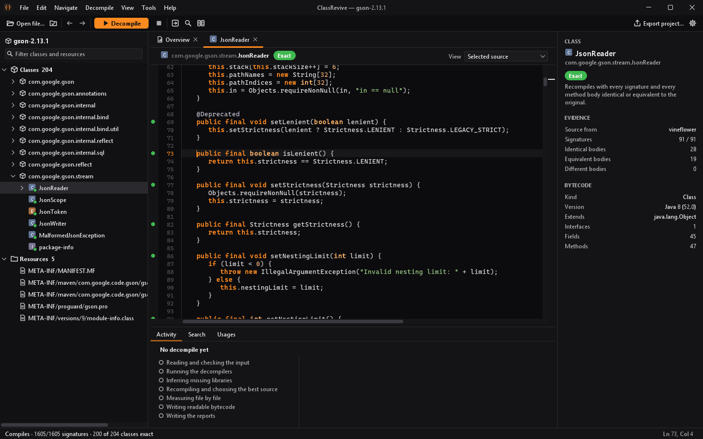

# ClassRevive

**Recover readable Java from compiled code, and measure how much of it is right.**

English | [Português (Brasil)](README.pt-BR.md)



ClassRevive runs four well-known Java decompilers (CFR, Vineflower, Procyon and JADX) on a `.class`, `.jar`, Android APK or an executable with an embedded jar. It recompiles every result with javac, compares it with the original bytecode, and keeps, file by file and method by method, the version the evidence supports. Every class ends up with a confidence level you can check, in a desktop application or on the command line.

## What it does

- **Decompiles with four engines and picks per file and per method.** Each engine runs in its own JVM. Candidates are ranked by whether they recompile, how many structural signatures match the original, and how many method bodies come back identical or equivalent after recompilation.
- **Verifies instead of guessing.** Every result says what was measured: recompilation, signatures per class, a round trip per method. Partial results keep a readable bytecode listing of what could not be recovered.
- **Handles awkward inputs.** Multi-release jars, class names that collide by letter case, executables that carry a jar, bundles of jars, Android APK and dex files (converted with dex2jar).
- **Detects obfuscation and undoes some of it.** A static profile names the techniques and the obfuscator they point to, with a score and the reasons. Two community obfuscators (Skidfuscator and Aidsfuscator) are reversed automatically, and Zelix KlassMaster opaque-predicate flags that are provably constant are folded.
- **Never runs the code it analyzes.** Target classes are never initialized and their methods are never invoked. See [Security](#security-and-responsible-use) for the precise boundary.

## What it does not do

- It does not prove that the recovered program behaves like the original. Behavior is always reported as `NOT_VERIFIED`.
- It cannot bring back what compilation threw away: comments, formatting and often local variable names.
- It does not recover names an obfuscator renamed, unless you supply the obfuscator's mapping file.
- Recompilation runs on JDK 21, so class files built for Java 22 or newer are read and listed but not verified.
- It is not a malware scanner or a sandbox. Its worker JVMs isolate faults, not hostile code.
- It does not decompile native code to Java. Bundled native libraries can be triaged, optionally with a Ghidra you install yourself.

## Quick start

**Requirement:** a Java 21 **JDK** (not only a JRE), because ClassRevive uses javac to check its results. [Eclipse Temurin 21](https://adoptium.net) works on Windows, Linux and macOS. `java -version` should print 21.

1. Download the zip of the latest release from the [Releases page](https://github.com/t1zzo/classrevive/releases) and unzip it anywhere.
2. Open the desktop application:

   ```bash
   bin/classrevive-gui
   ```

   On Windows, double-click `bin\classrevive-gui.bat`. Open or drop a `.jar`, press **F5** to decompile, and read each class with its confidence level.
3. Or use the command line:

   ```bash
   bin/classrevive decompile app.jar --engines all
   ```

   This writes a new `app-classrevive/` folder: the selected sources in `selection/sources/`, a confidence map in `report.html`, an IDE project in `project/`, and every engine's raw output next to them. Existing folders are never overwritten.

`classrevive --help` lists every command and `classrevive help decompile` explains one. To build from source instead, run `./gradlew :cli:installDist` with JDK 21; the launchers land in `modules/cli/build/install/classrevive/bin/`.

New to decompiling? Read [Getting started](docs/getting-started.md), or the [guia para iniciantes](docs/guia-iniciante.md) in Portuguese.

## Features

| Area | What you get | Docs |
|---|---|---|
| Desktop application | Package and class explorer, bytecode before any decompile, live progress with cancel, per-class confidence and per-method round-trip marks, javac errors underlined, side-by-side engine comparison, find usages and call hierarchy, go to class, code search, export as an IDE project, dark and light themes, English and Portuguese | [Getting started](docs/getting-started.md#4-the-desktop-application) |
| Verified selection | Recompilation, structural signatures, per-method round trip, bounded hybrids, compiler-guided source repairs, per-method composition across engines | [Architecture](ARCHITECTURE.md#selection-and-composition) |
| Inputs | `.class`, `.jar`, multi-release jars, executables with an embedded jar, bundles of jars, Android APK and dex | [CLI reference](docs/cli-reference.md#executables-bundles-and-android-inputs) |
| Missing libraries | Pass your own jars with `--classpath`; otherwise inferred stand-ins let the result compile, and it is marked stub-backed | [CLI reference](docs/cli-reference.md#selection-evidence-and-limits) |
| Obfuscation | Static technique profile and obfuscator hypotheses with scores; Skidfuscator and Aidsfuscator reversal; opaque-predicate flag folding; opt-in constant and string-decoding passes | [Obfuscation detection](docs/obfuscation-detection.md) |
| Renaming | Readable aliases, explicit mapping files, or a ProGuard/R8 mapping to restore original names where that is safe | [CLI reference](docs/cli-reference.md#rename-experimental) |
| Diagnostics | Static reflection, class-loading, invokedynamic and crypto clues; compiler fingerprint; embedded library recognition; optional Ghidra triage of native libraries | [CLI reference](docs/cli-reference.md#diagnose) |
| Reports | `report.txt`, `report.json` (schema v1), a self-contained `report.html` confidence map, IDE project export | [Report format](docs/reports.md) |
| Measurement | Benchmark command, a scoreboard on hash-checked Maven Central libraries, and a failure lab that turns failures into regression tests | [Benchmarks](docs/benchmarks.md) |

## How it works

```text
input (.class / .jar / .apk / .exe)
  │  bounded intake: read as data, never extracted or executed
  ▼
normalize ── dex2jar for Android · portable names · base version of multi-release jars
  │
  ▼
diagnose ── obfuscation profile; reverse a recognized obfuscator (checked by the JVM verifier)
  │
  ▼
CFR · Vineflower · Procyon · JADX        each in its own worker JVM
  │
  ▼
javac in a worker ── signatures per class · round trip per method
  │
  ▼
selection ── rank · hybrids · source repairs · per-method composition
  │
  ▼
selected sources + report.html / report.json + IDE project (+ bytecode fallback)
```

The details, including what each step refuses to do, are in [ARCHITECTURE.md](ARCHITECTURE.md).

## Benchmarks

The scoreboard decompiles real open-source libraries downloaded from Maven Central and checked by SHA-256. No rule in ClassRevive was tuned on the two holdout sets. Measured on 2026-10-29 with ClassRevive 0.1.0-dev, all four engines plus combined selection, on Windows with JDK 21:

| Set | Libraries | Compile as a whole | Signatures | Bodies, whole library | Bodies, with per-file credit |
|---|---:|---:|---:|---:|---:|
| `holdout` | 3 | 3/3 | 2,372/2,375 (99.8%) | 1,752/1,765 (99.2%) | 1,752/1,765 (99.2%) |
| `holdout2` | 13 | 5/13 | 21,583/52,080 (41.4%) | 8,774/38,445 (22.8%) | 35,899/38,445 (93.3%) |

- **Compile as a whole**: the selected sources of the whole library compile with javac against its declared dependencies. On `holdout2`, 8 of 13 libraries are still left with 1 to 33 javac errors.
- **Signatures**: classes, fields and methods whose structure matches the original, counted on the classes javac emitted; a library that does not compile contributes little here.
- **Bodies, whole library**: method bodies identical or equivalent to the original after recompilation, counted only for libraries that compile as a whole. The denominator is every method body of the original.
- **Bodies, with per-file credit**: the same, but each file of a library that does not compile is also compiled on its own against the original classes, and its bodies count when that file compiles. It measures how much of the code is right file by file, not a program you can rebuild.

None of these numbers measures behavior, and they say nothing certain about other inputs, especially obfuscated ones.

Reproduce them with a JDK 21 checkout:

```bash
./gradlew :cli:scoreboard -PscoreboardSet=holdout
./gradlew :cli:scoreboard -PscoreboardSet=holdout2
```

Each run writes `build/scoreboard/<set>-<timestamp>/benchmark.md`. Per-library numbers, the `dev` set and how to read every column are in [docs/benchmarks.md](docs/benchmarks.md).

## Security and responsible use

ClassRevive never runs the code it analyzes: no target class is initialized and no target method is invoked. Bytecode is read as data, and some passes evaluate pure constant code in a bounded static interpreter. After bytecode is rewritten (for example by an obfuscator reversal), the rewritten classes are linked, never initialized, in a separate worker JVM so that the JVM verifier can check them. Decompilers, javac and the other heavy steps run in separate worker JVMs with time, memory and output limits. That is fault isolation, **not an operating-system sandbox**: analyze deliberately hostile files inside a virtual machine.

Only analyze software you have the right to analyze: your own code, open-source code, or cases your license or the law allows. Read the [disclaimer](DISCLAIMER.md) before using ClassRevive on third-party software, and see [SECURITY.md](SECURITY.md) to report a vulnerability. Please do not attach private or proprietary binaries to public issues.

Obfuscator and product names (Zelix KlassMaster, Allatori, DashO, Stringer, ProGuard, R8, Skidfuscator, Aidsfuscator and others) belong to their owners. ClassRevive is not affiliated with any of them, and its detection is heuristic.

## Documentation

- [Getting started](docs/getting-started.md) · [Guia para iniciantes (português)](docs/guia-iniciante.md)
- [Command-line reference](docs/cli-reference.md)
- [Architecture](ARCHITECTURE.md) and [status: what works and what remains](docs/status.md)
- [Report format](docs/reports.md) · [Obfuscation detection](docs/obfuscation-detection.md) · [Dynamic-linkage diagnostics](docs/dynamic-diagnostics.md)
- [Benchmarks](docs/benchmarks.md) · [Changelog](CHANGELOG.md)
- Experimental: [pass API](docs/pass-sdk.md), [sandbox](docs/sandbox.md), [behavior protocol](docs/behavior-protocol.md)


## Contributing

Bug reports, fixtures and pull requests are welcome; see [CONTRIBUTING.md](CONTRIBUTING.md). The full check is `./gradlew test :cli:installDist :cli:distZip`. A failure case reduced from your own or openly licensed code, through the [failure lab](docs/cli-reference.md#failure-lab), is the most useful bug report.

## License

ClassRevive is licensed under the [Apache License 2.0](LICENSE). The distribution bundles CFR (MIT), Vineflower, Procyon and JADX (Apache-2.0), ASM (BSD-3-Clause), FlatLaf (Apache-2.0), RSyntaxTextArea (BSD-3-Clause), dex2jar (Apache-2.0) and other libraries under their own licenses; see [NOTICE](NOTICE), [THIRD_PARTY_NOTICES.md](THIRD_PARTY_NOTICES.md) and [third-party-licenses/](third-party-licenses/).
