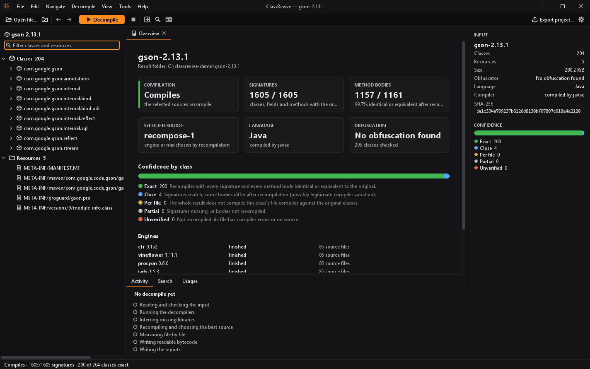
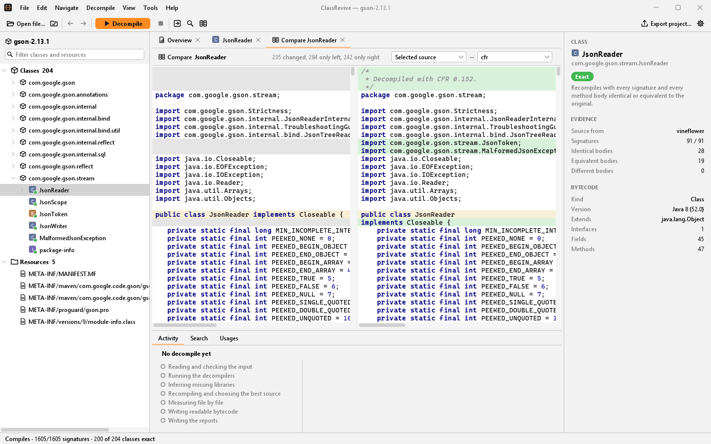

# Getting started

This guide is for people who have never decompiled anything. It shows how to install ClassRevive, decompile a jar in the desktop application or on the command line, and understand the result. A Portuguese version is in [guia-iniciante.md](guia-iniciante.md).

## 1. What decompiling means

A Java program is usually shipped compiled: instead of the `.java` files the programmer wrote, you get `.class` files, often packed together in a `.jar`. Those files are meant for the Java virtual machine, not for people. **Decompiling** goes the other way, turning `.class` and `.jar` files back into readable `.java` code.

ClassRevive does not decompile on its own. It runs **four established decompilers** (CFR, Vineflower, Procyon and JADX), compares their results and keeps the best one, file by file and even method by method. Then it **checks** the result: it recompiles the generated code and compares it with the original bytecode.

| It does | It does not |
|---|---|
| Turn a `.jar`, `.class`, Android `.apk` or an `.exe` with an embedded jar into `.java` code | Bring back comments, formatting or most local variable names; compilation discarded them |
| Check whether the generated code compiles again | Prove that the program behaves like the original |
| Tell you how many methods came back identical or equivalent to the original | Run the program it analyzes; that is deliberate, for safety |
| Read class files of any Java version up to 28 | Recompile and verify class files built for Java 22 or newer |

> **Only decompile software you have the right to analyze**: your own code, open-source code, or cases your license or the law allows. See the [disclaimer](../DISCLAIMER.md).

## 2. What you need installed

Just one thing: a **Java 21 JDK**.

1. Download **Eclipse Temurin 21 (JDK)** from [adoptium.net](https://adoptium.net) for your system (on Windows, the `.msi` installer).
2. Install it with the default options. On Windows, if you see **Set JAVA_HOME variable**, enable it.
3. Check it: open a terminal (PowerShell on Windows, Terminal on macOS or Linux) and run:

   ```bash
   java -version
   ```

   The output should mention `21`, for example `openjdk version "21.0.12"`. If the command is not found, close and reopen the terminal; if it still fails, reinstall and enable the PATH/JAVA_HOME option.

> It has to be the **JDK**, not only a JRE: ClassRevive uses the Java compiler to check its results.

## 3. Get ClassRevive

Download the zip of the latest release from the [Releases page](https://github.com/t1zzo/classrevive/releases) and unzip it into a folder of your choice, for example `Documents\classrevive` on Windows or `~/classrevive` on macOS and Linux. Inside you will find:

| Folder | Contents |
|---|---|
| `bin/` | the launchers: `classrevive-gui` (desktop application) and `classrevive` (command line), with `.bat` versions for Windows |
| `lib/` | the program and the decompilers it runs |
| `docs/` | this documentation |
| `third-party-licenses/` | license texts of the bundled libraries |

To check that it works, open a terminal in that folder and run:

```bash
bin/classrevive engines
```

On Windows, write `bin\classrevive.bat engines`. It should list the four decompilers (`cfr`, `vineflower`, `procyon`, `jadx`) with their versions.

<details>
<summary>Building from source instead</summary>

With a JDK 21 and a checkout of the repository, run `./gradlew :cli:installDist` (`.\gradlew.bat :cli:installDist` on Windows). The first build downloads its dependencies and takes a few minutes. The launchers are then in `modules/cli/build/install/classrevive/bin/`. See the [command-line reference](cli-reference.md#build-from-source).

</details>

## 4. The desktop application

Start `bin/classrevive-gui` (on Windows, double-click `bin\classrevive-gui.bat`).

1. **Open a file.** Use **Open file…** or drop a `.jar`, `.class`, `.apk` or `.exe` on the window. The explorer on the left lists packages, classes and resources right away; you can read any class's bytecode before decompiling.
2. **Decompile.** Press **F5** (or the orange **Decompile** button). The activity panel at the bottom shows each step live, and the stop button cancels. **Decompile with options…** lets you pick the engines, the time limit and the libraries the program needs; the defaults are fine to start with.
3. **Read the result.** Click a class. Its selected source opens with highlighting, line numbers and folding. The **View** box at the top switches to any single engine's version or to the bytecode.



What the screen tells you:

- **Confidence level.** Every class carries one: *exact*, *close*, *per file*, *partial* or *unverified* (see [section 6](#6-understanding-the-result)). It appears in the tree, above the editor and in the inspector on the right.
- **Round-trip dots.** In the selected source, each method has a dot in the margin: green when its recompiled body is identical or equivalent to the original, other colors when it differs. javac errors are underlined.
- **Obfuscation banner.** When the bytecode points to a known obfuscator, a banner names it with its evidence. For Skidfuscator and Aidsfuscator, ClassRevive can reverse the jar before decompiling.

Useful keys:

| Key | Action |
|---|---|
| F5 | Decompile |
| Ctrl+N | Go to a class by name |
| Ctrl+F / Ctrl+Shift+F | Find in the current file / search all code |
| Ctrl+click, Alt+Left / Alt+Right | Open the class under the mouse, go back and forward |
| Ctrl+D | Compare two engines side by side |
| Alt+F7 | Find usages of the class, method or field under the caret |
| Ctrl+Alt+H | Call hierarchy of a method |
| Ctrl+, | Settings: theme (dark or light), language (English or Portuguese), font size, default engines, time limit, results folder |



Each decompile writes a new folder under the results folder (by default `%APPDATA%\ClassRevive\workspaces` on Windows), with the same layout as the command line below. **Open result…** reopens any such folder, and **Export project…** saves the sources as an IDE project or a zip.

## 5. The command line

Suppose you want to decompile `Downloads/program.jar`:

```bash
bin/classrevive decompile ~/Downloads/program.jar --output ~/Downloads/program-decompiled --engines all
```

On Windows:

```powershell
bin\classrevive.bat decompile "$HOME\Downloads\program.jar" --output "$HOME\Downloads\program-decompiled" --engines all
```

| Part | Meaning |
|---|---|
| `decompile` | what you want to do |
| `program.jar` | the input file (`.jar`, `.class`, `.apk`, `.dex` or an `.exe` that carries a jar) |
| `--output ...` | where to put the result. **It must be a folder that does not exist yet**; ClassRevive creates it. Without `--output`, it creates `program-classrevive` in the current folder |
| `--engines all` | use all four decompilers. Without it, only CFR and Vineflower run, which is faster but usually gives a worse result |

Paths with spaces need quotes. A small jar takes some tens of seconds; a big one (thousands of classes) can take several minutes.

## 6. Understanding the result

### The summary line

At the end the command prints something like this:

```text
Selected: recompose-1 | compilation=COMPILED | signatures=478/479 | placeholder-signals=1
Sources: selection/sources. Behavior not verified; see selection/selection.txt for evidence.
```

| Part | Meaning |
|---|---|
| `compilation=COMPILED` | **The generated code compiles.** This is the main sign of success. `COMPILE_FAILED` means part of the code has errors |
| `signatures=478/479` | Of the program's 479 pieces of structure (classes, methods, fields), 478 came back with exactly the original shape. The closer to the total, the better |
| `placeholder-signals=1` | Places that look like holes a decompiler left. Sometimes a false alarm: a `throw new UnsupportedOperationException(...)` the original author wrote also counts |
| `Behavior not verified` | An honest reminder: compiling does not prove the program does exactly the same thing |

### Where the code is

The sources are in `program-decompiled/selection/sources/`, in folders by package (for example `org/json/JSONObject.java`). Any editor works; a Java IDE such as IntelliJ IDEA Community or VS Code with the Java extension makes reading much easier.

`program-decompiled/project/` is a **ready-made project**: the code in `src/main/java`, the jar's resources in `src/main/resources`, the libraries you passed with `--classpath` in `lib/`, and a `build.gradle`. Open that folder in your IDE and import it as a Gradle project.

### How much to trust each class

Open `program-decompiled/report.html` in a browser. It is a **confidence map** with a color per class:

| Level | Meaning |
|---|---|
| **exact** (green) | every method came back identical or equivalent to the original |
| **close** (light green) | it compiles, but some methods differ |
| **per file** (blue) | the whole program does not compile, but this class's file does |
| **partial** (orange) | parts of the structure are missing |
| **unverified** (red) | it could not be checked because the file has errors |

### Everything else in the folder

| Path | Purpose |
|---|---|
| `selection/sources/` | **the final result**: the best code chosen |
| `project/` | the same code as an IDE project |
| `report.html` | the confidence map |
| `report.txt` | a text summary of what happened |
| `report.json` | the same with every detail, for scripts ([format](reports.md)) |
| `selection/selection.txt` | the selection log: what each decompiler achieved and what was repaired |
| `cfr/`, `vineflower/`, `procyon/`, `jadx/` | each decompiler's raw output |
| `fallback/bytecode/` | a readable listing of the original instructions, for anything that did not decompile |
| `input.jar`, `classes.jar` | copies of the input used during the run |

### Exit codes (for scripts)

| Code | Meaning |
|---|---|
| `0` | everything checked out: it compiles with every signature and no placeholder signals |
| `1` | finished with something partial: missing signatures, placeholder signals or compile errors. **This is the most common case, and the code can still be very good**; look at the `Selected:` line |
| `2` | the command was typed wrong |
| `130` | interrupted (Ctrl+C) |

## 7. When the program depends on other libraries

Most programs use third-party libraries that are not inside the jar you decompile. Without them the recompilation check cannot compile everything. ClassRevive then infers stand-ins for the missing types so the result can still be checked, and marks it **stub-backed**: its signatures were compared against guesses, not the real library. `report.json` lists what was missing:

```text
missing packages (supply with --classpath): org.tukaani.xz (27), ...
```

If you have those jars, pass them with `--classpath`, separated by `;` on Windows and `:` on macOS and Linux:

```bash
bin/classrevive decompile gson-2.13.1.jar --engines all --classpath error_prone_annotations-2.38.0.jar
```

Jars passed this way are only read by the compiler during the check. They are never executed and do not end up in the result. In the desktop application, add them under **Libraries (optional)** in **Decompile with options…**.

## 8. Common problems

| Message or symptom | What to do |
|---|---|
| `Output already exists` | The `--output` folder already exists. Pick another name; ClassRevive never deletes earlier results |
| `java` is not recognized | The JDK 21 is not installed, or the terminal was opened before the installation. See section 2 |
| `compilation=WORKER_FAILED` | The compiler did not run. Check with `javac -version` that a JDK 21 is installed; a JRE is not enough |
| Very slow, or `TIMED_OUT` | Raise the limit per step, in seconds: `--timeout-seconds 600` (default 120, maximum 3600) |
| `UNSUPPORTED_RELEASE` | The program was built for Java 22 or newer; its recompilation cannot be checked yet. |
| `compilation=COMPILE_FAILED` | Part of the code did not compile. See section 7 (missing libraries). The files with problems are listed in `selection/selection.txt`, and the code is still in `selection/sources/` for reading |

## 9. Other useful commands

| Command | Purpose |
|---|---|
| `classrevive inspect file.jar` | list what is inside (each class and the Java version it targets) without decompiling |
| `classrevive identify file.exe` | say what a file is and whether it holds Java |
| `classrevive diagnose file.jar` | static triage: obfuscation techniques, reflection, class loading, crypto |
| `classrevive engines` | list the decompilers and their versions |
| `classrevive --help` | list every command; `classrevive help <command>` explains one |

The advanced commands (`transform`, `rename`, `benchmark`, `lab`) are described in the [command-line reference](cli-reference.md).

## 10. Glossary

- **`.class`**: one compiled Java class.
- **`.jar`**: a zip with many `.class` files, and sometimes images and configuration.
- **Decompiler**: a program that goes back from `.class` to `.java`.
- **Compile**: turn `.java` into `.class`. ClassRevive recompiles its result to check it.
- **Signature**: the shape of a class, method or field: its name, parameters, type and modifiers.
- **Round trip**: recompiling a decompiled method and comparing it with the original, instruction by instruction. When they match, the method came back faithfully.
- **Obfuscation**: deliberately scrambling a program to make it harder to read, for example by renaming everything to short meaningless names. ClassRevive detects common obfuscation and reverses some of it, but it cannot recover renamed names without the obfuscator's mapping file.
